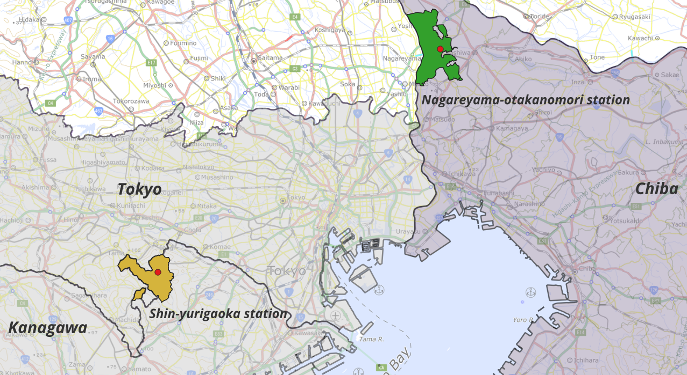
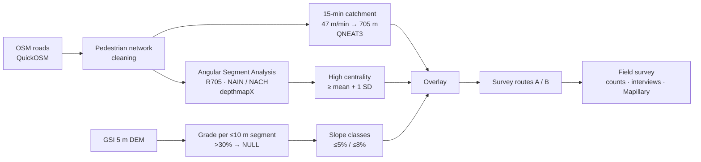
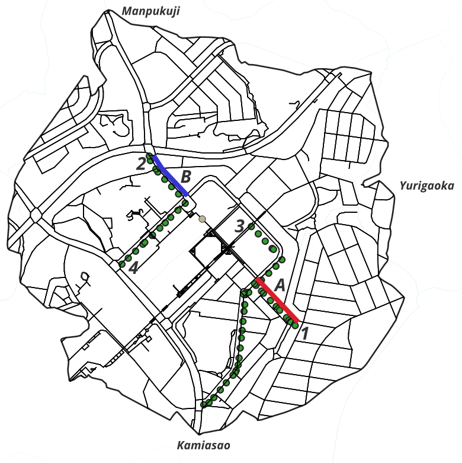
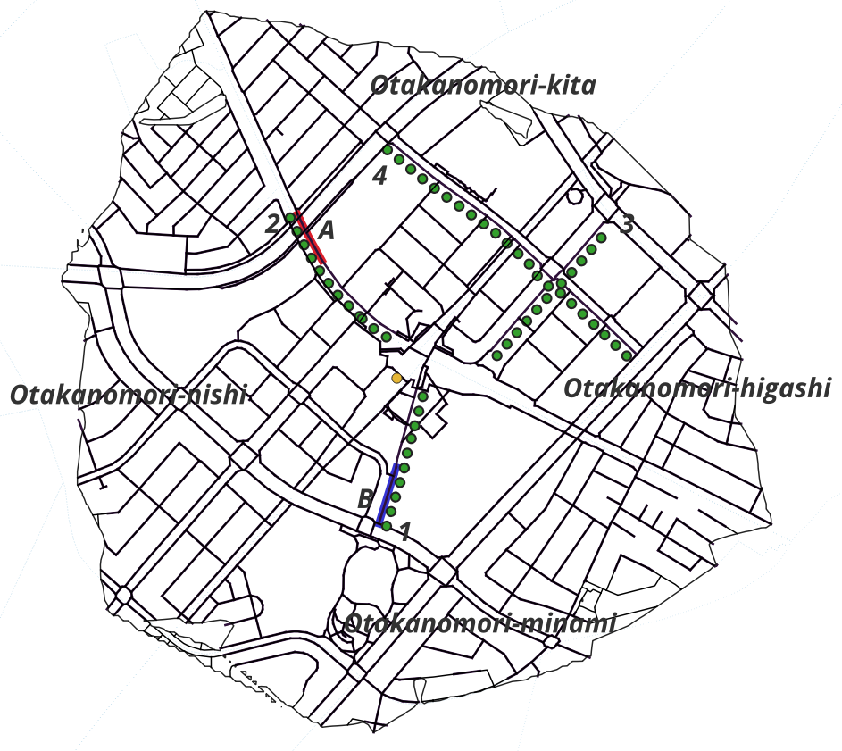

# Walkability for Elderly People in Hilly and Flat Station Areas

**Shin-Yurigaoka Station (hilly) vs. Nagareyama-Otakanomori Station (flat), Tokyo metropolitan area**

[日本語版はこちら / Japanese version](README.ja.md)

> Terado, H. (2026). How Does Walkability for Elderly People Differ between Hilly and Flat Urban Areas? A Case Study of Shin-Yurigaoka Station and Nagareyama-Otakanomori Station. *Int. Arch. Photogramm. Remote Sens. Spatial Inf. Sci.*, L-4/W1-2026, 311–318. FOSS4G 2026 Academic Track (Hiroshima). [doi:10.5194/isprs-archives-L-4-W1-2026-311-2026](https://doi.org/10.5194/isprs-archives-L-4-W1-2026-311-2026)

**Keywords:** Walkability · Elderly People · Space Syntax · Angular Segment Analysis · Slope Analysis · Suburban Railway Station Areas

**Tools & data (all open):** QGIS · QuickOSM · QNEAT3 · Space Syntax Toolkit · depthmapX · OpenStreetMap · GSI 5 m DEM · Mapillary


*Figure 1. Location of the study areas: Shin-Yurigaoka Station (Kawasaki, Kanagawa) and Nagareyama-Otakanomori Station (Nagareyama, Chiba). Basemap © OpenStreetMap contributors.*

---

## Introduction

### Background
Station areas in Japan's ageing suburbs need streets that elderly people can walk comfortably in daily life. Conventional walkability assessments focus mainly on street connectivity and proximity to destinations. They do not fully capture burdens specific to elderly walkers, such as slopes and elevation differences.

### Research gap
Many previous studies evaluate walkable street networks for the general population. Few studies combine three things:

- walking catchments based on the walking speed of elderly people,
- hilly suburban station areas in Japan,
- field verification of the GIS results.

### Research question
> *Are the streets that Space Syntax identifies as central in the street network also streets that elderly people can walk comfortably?*

### Approach
The study combines Space Syntax street-network analysis with DEM-based slope analysis. It compares a hilly station area with a flat one; the two also differ in how the town was developed. Field observation and interviews then check the GIS results against the actual walking environment.

## Methods



| Step | Setting |
|---|---|
| Study areas | **Shin-Yurigaoka** (Asao Ward, Kawasaki): hilly, land readjustment about 40 years ago · **Nagareyama-Otakanomori** (Nagareyama, Chiba): flat, newly planned ~30 ha station-front district |
| Catchment | 15 minutes at **47 m/min** (elderly walking speed) = **705 m** network distance |
| Network | OSM pedestrian network, including decks, stairs, ramps, crosswalks and sidewalks. Private, parking and indoor roads removed. Intersection splitting, snapping, Douglas-Peucker simplification, geometry repair. |
| Centrality | Angular Segment Analysis, metric radius 705 m. **NAIN** (to-movement) and **NACH** (through-movement). "High" = **mean + 1 SD** or above. |
| Slope | Network split into segments of up to 10 m. Grade = \|Z<sub>end</sub> − Z<sub>start</sub>\| / length × 100. Values above 30% set to NULL. Aggregated to Space Syntax segments. |
| Thresholds | **≤ 5%** (low slope) and **≤ 8%** (tolerance), following MLIT sidewalk gradient standards |
| Field survey | 11 May (Shin-Yurigaoka) and 18 May 2026 (Nagareyama): 15-min pedestrian counts, interviews with people aged 65+ (5-point scales), Mapillary capture of coverage gaps |

Full procedure: [docs/methodology.md](docs/methodology.md)

## Results

**Network and slope.** The two catchments are similar in size: 89.4 ha vs. 94.7 ha, with 34.2 km vs. 33.2 km of road. Their slope profiles differ sharply.

| Slope (share of road length) | Shin-Yurigaoka | Nagareyama-Otakanomori |
|---|---|---|
| ≤ 5% | 54.2% | 68.6% |
| 5–8% | 24.5% | 2.7% |
| > 8% | 21.2% | 2.4% |
| No data (decks, etc.) | 0% | 26.2% |

**Centrality.** High-NAIN road length is similar at both stations (6.28 km vs. 6.41 km). High-NACH roads are much more extensive at Shin-Yurigaoka (2.28 km vs. 0.80 km). The two measures also overlap far more there (Jaccard index 22.8% vs. 5.7%).

**Centrality × slope.** At Shin-Yurigaoka, relaxing the slope threshold from 5% to 8% adds **1.89 km** of High-NAIN road; at Nagareyama the gain is only **0.15 km**. Many central streets at Shin-Yurigaoka therefore lie on moderate slopes.

| Overlay | Shin-Yurigaoka | Nagareyama-Otakanomori |
|---|---|---|
| High NAIN ∩ ≤ 5% | 3.36 km (9.8%) | 4.02 km (12.1%) |
| High NAIN ∩ ≤ 8% | 5.25 km (15.4%) | 4.17 km (12.6%) |
| High NACH ∩ ≤ 5% | 1.75 km (5.1%) | 0.61 km (1.8%) |
| High NACH ∩ ≤ 8% | 2.05 km (6.0%) | 0.61 km (1.8%) |

<table>
<tr><th></th><th>Shin-Yurigaoka</th><th>Nagareyama-Otakanomori</th></tr>
<tr><th>High NAIN</th><td></td><td></td></tr>
<tr><th>High NACH</th><td></td><td></td></tr>
</table>

*Figure 2. High-centrality roads by slope, within the 15-minute catchment. Dark red / dark blue: High NAIN / High NACH roads with slope ≤ 5%. Light pink / light purple: High NAIN / High NACH roads with slope 5–8%. At Shin-Yurigaoka many central roads fall in the 5–8% class; at Nagareyama-Otakanomori almost none do.*

**Field survey at Shin-Yurigaoka.** Both routes passed the ≤ 5% condition on mean slope and carried similar pedestrian counts. Elderly respondents rated them very differently.

| Route | GIS condition | Mean / max slope | Pedestrians (15 min) | Ease of walking (1–5) | Comfort (1–5) |
|---|---|---|---|---|---|
| A: pedestrian space | High NAIN ∩ ≤ 5% | 2.06% / 4.57% | 159 | **4.25** (n = 8) | 4.38 |
| B: roadside access | High NACH ∩ ≤ 5% | 4.61% / **11.97%** | 143 | **2.60** (n = 5) | 3.60 |

At Nagareyama-Otakanomori, both routes scored 5.00, but with only 4 respondents in total, so this result is not interpreted.

<table>
<tr><th>Shin-Yurigaoka</th><th>Nagareyama-Otakanomori</th></tr>
<tr><td></td><td></td></tr>
</table>

*Figure 3. Field-survey routes and Mapillary capture routes. Red: Route A (High NAIN ∩ ≤ 5%). Blue: Route B (High NACH ∩ ≤ 5%, not overlapping Route A). Green dots: Mapillary capture routes 1–4.*

## Discussion

- **Central does not mean walkable.** NAIN and NACH describe a street's position in the network. They do not reflect slope, sidewalk width, level differences or traffic. At Shin-Yurigaoka, central streets, especially through-movement (NACH) streets, include slopes that may burden elderly people.
- **Planning shows up in the network.** At Nagareyama-Otakanomori, through-movement is concentrated on a few roads, while low-slope, to-movement streets are spread widely. This matches the district's pedestrian-priority design, which includes sidewalk widening by one-way conversion and slalom-style speed reduction.
- **GIS alone is not enough.** Routes A and B at Shin-Yurigaoka both had a mean slope of 5% or less but were perceived very differently. Ease of walking depends on more than GIS indicators.
- **Practical use.** The method can identify roads that are central (High NAIN or NACH) but carry large slope burdens, and flag them as priority targets for improvement.
- **Limitations.**
  - Only two station areas were studied.
  - Respondents were few, and the survey covered a limited time window.
  - A DEM cannot represent bridges, decks, stairs or grade-separated crossings.
  - OSM road-class and sidewalk data are imperfect.

### Additional reflection (beyond the paper)
Grades were computed per 10 m segment and then averaged onto each Space Syntax segment. Averaging can hide a short steep section. Route B at Shin-Yurigaoka passed the ≤ 5% condition on its mean slope (4.61%), but its steepest part reached 11.97%. Its low ease-of-walking score (2.60), however, cannot simply be attributed to that section: respondents mainly mentioned the narrow sidewalk, described the slope as gentle, and two called the walk good exercise. A natural next check is to aggregate with the maximum or 95th percentile instead of the mean and see how the classification changes. See [decisions.md](docs/decisions.md#4-勾配--slope).

## Conclusion

Combining Space Syntax with slope analysis makes visible the gap between streets that are structurally central and streets that elderly people can walk comfortably. In a hilly area, important streets in the network are not necessarily easy for elderly people to walk on. The workflow uses only open data and open-source GIS tools, so it can be applied to station areas in other regions.

**Next steps:**

- more station areas,
- additional factors: sidewalk width, signals, crosswalks, stairs, decks and land use,
- 3D city models and street-level imagery, to evaluate slopes, stairs and level differences in three dimensions,
- participatory and GeoAI-based evaluation that captures elderly people's own perceptions.

---

## Research process

This study took about four months, from February to May 2026. The full working notes are published here, including approaches that were later revised.

- [**Work log**](docs/worklog/README.md): 27 dated notes and one undated memo, with English summaries, covering site selection, network cleaning, slope calculation, analysis, conference preparation and field survey.
- [**Decision record**](docs/decisions.md): what was decided, when and why, for the study areas, walking speed, slope thresholds, centrality definition and survey routes.

## Repository structure

```
README.md            English overview (IMRAD)
README.ja.md         Japanese overview
docs/methodology.md  Detailed procedure
docs/decisions.md    Decision record
docs/worklog/        Work log, Feb–May 2026
figures/             Figures
licenses/            Licence texts
```

## License

Unless otherwise stated, original text and figures in this repository are released under [CC BY 4.0](https://creativecommons.org/licenses/by/4.0/). See [licenses/](licenses/README.md) for details. Third-party data (OpenStreetMap © contributors, ODbL; GSI; Mapillary, CC BY-SA) remain under their own licences.
