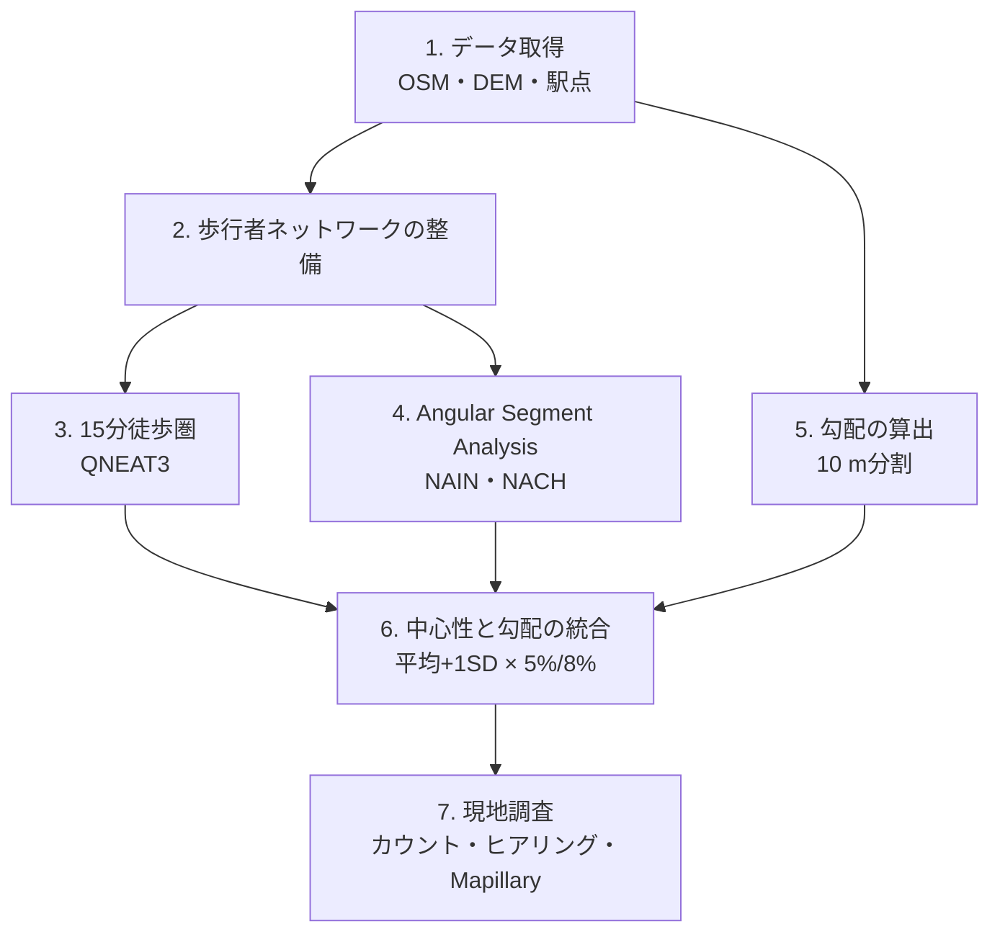

# 研究方法・分析手順 / Methodology

論文（[Terado, 2026](https://doi.org/10.5194/isprs-archives-L-4-W1-2026-311-2026)）の最終版の手順を、QGIS上で手作業で再現できる粒度でまとめたものです。設定値は論文の値に合わせています。途中で試した設定や変更の経緯は、[作業ログ](worklog/README.md)と[判断の記録](decisions.md)を参照してください。

[← README](../README.md)

---

## 全体の流れ / Workflow



## 1. データ / Data

| データ | 内容・取得方法 | ライセンス |
|---|---|---|
| 道路 | OpenStreetMap。QGISプラグイン QuickOSM で `highway` を取得 | ODbL |
| 標高 | 国土地理院 基盤地図情報 数値標高モデル 5 mメッシュ（[ダウンロードサービス](https://service.gsi.go.jp/kiban/)） | 国土地理院の利用規約 |
| 駅中心点 | 駅ごとに点を作成 | — |
| 街路画像 | Mapillary（既存画像の確認と、未撮影区間の撮影） | CC BY-SA |
| 現地調査 | 歩行者カウント、ヒアリング票 | — |

座標系は、メートル単位の平面直角座標系（JGD2011）にそろえます。WGS84のままでは距離を扱えません。

## 2. 歩行者ネットワークの整備 / Pedestrian network

徒歩圏より広い範囲（駅から約2 km）で道路を切り出して整備し、解析後に徒歩圏で切り出します。

### 2.1 含める道・除く道

- **含める**：駅前の歩行者デッキと、そこから駅・街へ出る通路／デッキと地上を結ぶ階段・EV・スロープ／横断歩道／主要な道路（`primary`・`tertiary`）沿いの歩道
- **除く**：`motorway`、`motorway_link`／私道 `"access"='private'`／駐車場内の通路 `"service"='parking_aisle'`／屋内 `"indoor"='yes'`
- 流山おおたかの森では、さらに `"barrier"='kerb'`、`"service"='driveway'` を除外しました
- 主要道路以外では歩道を別の線として持たず、車道の中心線に統合します（歩道と車道が並行して二重にならないようにするため）

### 2.2 クリーニング

1. **レイヤを分ける**：地上レイヤ／立体レイヤ（`"layer"=1 or "bridge"='yes' or "tunnel"='yes'`）／階段（`"highway"='steps'`）の3つに分けます
2. **地上レイヤ**：重複ジオメトリの削除 → 交差点での分割 → スナップ（許容値 0.5 m、頂点は追加しない）
3. **簡略化**：Douglas-Peucker 法、許容値 1.0 m（狭い道で線が建物にかからない程度）
4. **統合**：3つのレイヤをマージ → 重複の削除 → ジオメトリの修復
5. **確認**：Space Syntax Toolkit の *Verify layer* で、孤立した線（island・orphan）を除去

手作業の修正は、ロータリーや食い違い交差点など最小限にとどめました。修正しすぎるとネットワークの接続が崩れるためです（参考：Kolovou et al., 2017）。

## 3. 15分徒歩圏 / Walking catchment

- 歩行速度：**47 m/分**（65歳以上）→ 15分で **705 m**
- ツール：QNEAT3 *Iso-Area as Polygons (from Point)*
  - 最適化：Fastest path（時間）
  - 等時間線の間隔：300 / 600 / 900 秒
  - 方向：both directions

## 4. Space Syntax（Angular Segment Analysis）

- ツール：Space Syntax Toolkit（QGIS）＋ depthmapXnet
- 解析：Angular Segment Analysis。解析半径（Metric Radius）は徒歩圏に合わせて **705 m**
- 解析範囲：駅から約2 kmのネットワーク全体で計算し、その後で15分徒歩圏に切り出す。徒歩圏だけで計算すると、範囲の端にある道は周りの道路とのつながりが途中で切れ、中心性が正しく計算されないため（エッジ効果）
- 指標：
  - **NAIN**（Normalised Angular Integration）：目的地へ向かう動き（to-movement）のしやすさ
  - **NACH**（Normalised Angular Choice）：通り抜けの動き（through-movement）の通りやすさ（Hillier et al., 2012）

## 5. 勾配 / Slope

1. 道路を **最大10 m** に分割：*Split lines by maximum length*。分割後に一意のIDを付与
2. 始点と終点を抽出：*Extract specific vertices*（vertex = 0 と -1）
3. DEMから標高を付与：*Sample raster values* で `Zstart` と `Zend` を作成
4. IDで線に結合（空間結合より誤結合が起きにくい）
5. 勾配を計算：

   ```
   abs("Zend" - "Zstart") / $length * 100
   ```

   分母は10の固定値ではなく、各線分の実際の長さです。
6. 外れ値の処理：DEMは地表面の標高なので、橋や立体交差で異常に急な値が出ます。30%を超える値は値だけNULLにし、地物は残します：

   ```
   CASE WHEN "grade_pct" > 30 THEN NULL ELSE "grade_pct" END
   ```

## 6. 中心性と勾配の統合 / Integration

1. **勾配をSpace Syntaxのセグメントに集約**：*Join attributes by location (summary)*。空間関係は intersects、集計は mean
2. **高中心性の抽出**：NAIN、NACH それぞれで **平均＋1SD 以上** を High_NAIN、High_NACH とする。平均と標準偏差は、2 km範囲で計算した値を15分徒歩圏で切り出した後、**駅ごとに徒歩圏内のセグメントだけ**で求める（新百合ヶ丘で High_NAIN の延長が論文の 6,280.75 m と一致することを確認済み）
3. **勾配による分類**：**5%以下**（低勾配）と **8%以下**（許容範囲）。国交省の歩道の勾配基準による
4. **重ね合わせ**：High_NAIN と High_NACH を、それぞれ 5%以下・8%以下の道路と重ね、徒歩圏内の道路延長に占める延長と割合を集計
5. **2つの指標の重なり**：High_NAIN と High_NACH の Jaccard 指数と、互いの重なりの割合を計算

## 7. 現地調査 / Field survey

| 項目 | 内容 |
|---|---|
| 日程 | 2026年5月11日（新百合ヶ丘）、5月18日（流山おおたかの森）。いずれも晴れ |
| ルート | **A**：High_NAIN ∩ 5%以下／**B**：High_NACH ∩ 5%以下（Aとは重ならない区間）。長さが同程度で、性格の異なる区間を選定 |
| 歩行者カウント | 10:30〜10:45。5分ごとに記録。見た目で高齢者と高齢者以外に分けて数えた |
| ヒアリング | 10:45〜11:30、調査員2名。65歳以上が対象。歩きやすさ・安心感・快適さを5段階で評価し、理由を自由回答で聞いた |
| Mapillary | 高中心性の道のうち、既存画像がない区間や夜間の画像しかない区間を撮影（ルート1〜4） |

調査票は個人を特定できる情報を記録しない形式で作成しました。

## 限界 / Limitations

- DEMは地表面の標高なので、橋・デッキ・階段・立体交差を表せません。デッキ上などは勾配が「データなし」になります。
- 勾配はセグメント単位の平均なので、短い急坂が埋もれる可能性があります（詳しくは [decisions.md](decisions.md#4-勾配--slope)）。
- OSMの道路種別や歩道の情報には精度の限界があります。
- 現地調査の回答者は少なく（新百合ヶ丘13名、流山4名）、時間帯も限られています。
