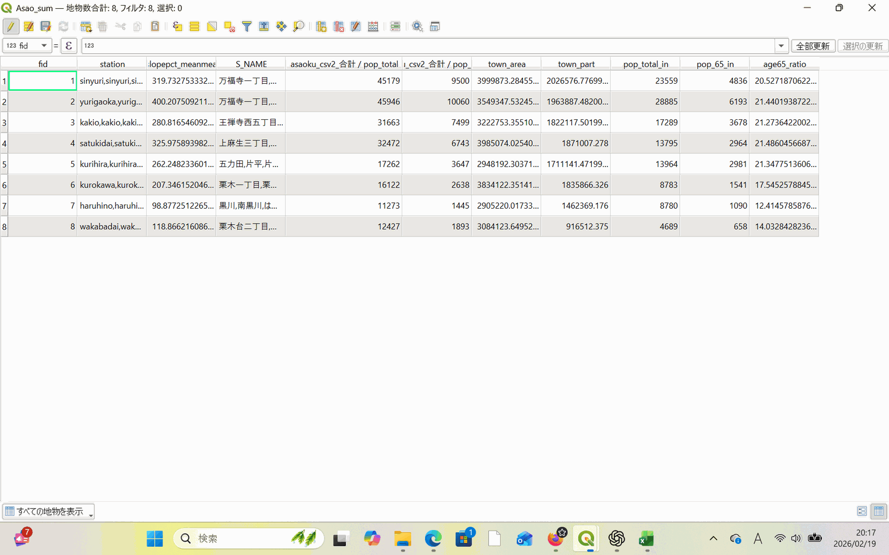
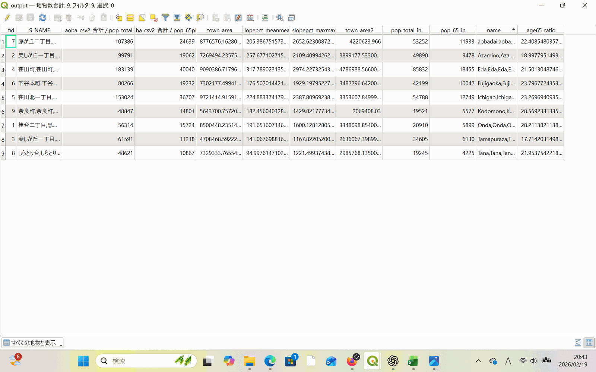
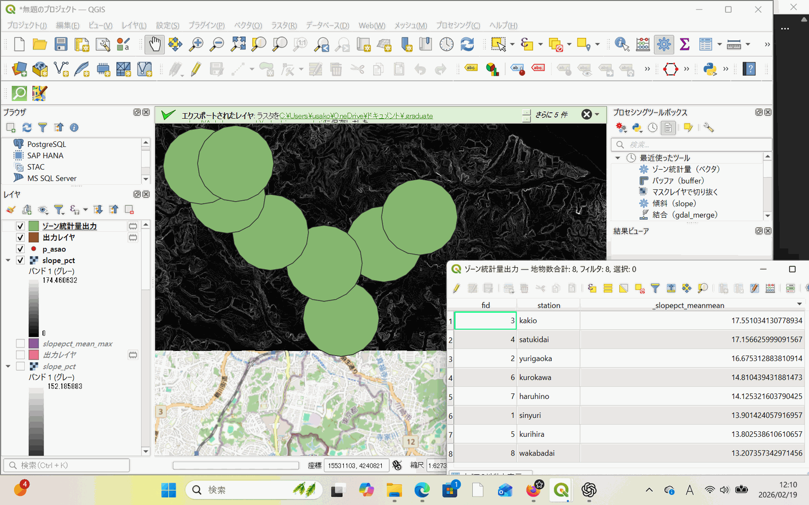
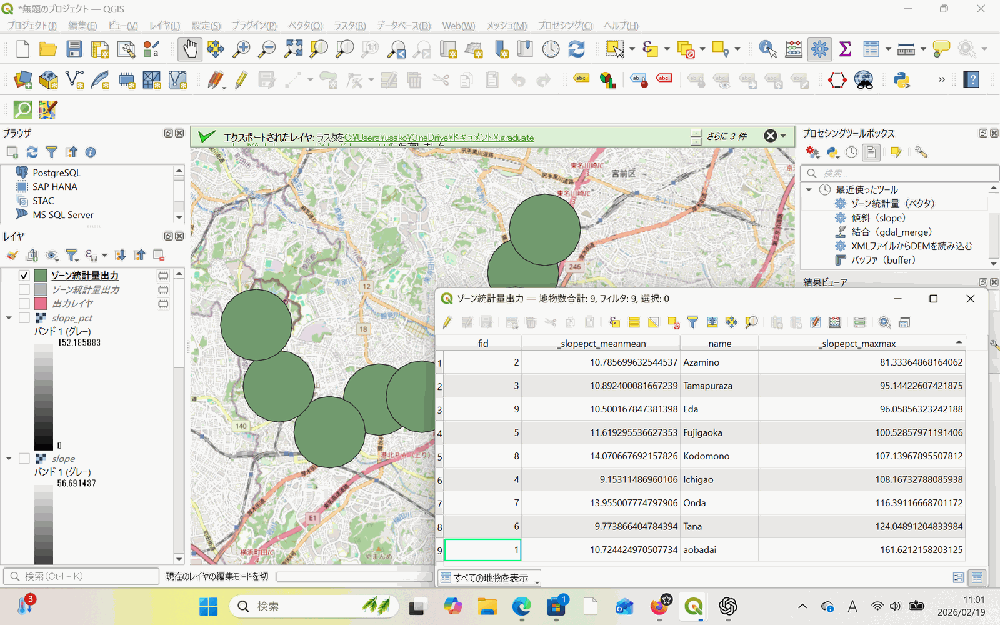

# 2026-02-19 「駅周辺の高齢化率（65+割合）」を1km圏で出す手順

> **Summary (EN):** Estimated the share of residents aged 65+ within each station's 1 km buffer by joining town-block (町丁) age data from the Yokohama/Kawasaki resident registers (end of Sept. 2025) to e-Stat census boundaries and applying areal weighting. Shin-Yurigaoka came out at 20.53%; combining ageing rate and mean slope, Tana (21.95%, 9.774%) was chosen as the main flat comparison station, with Eda as backup and Ichigao as an additional candidate.
>
> **Phase:** 1. Site selection (駅選定) · **Tools/Data:** QGIS (Join, Intersection, Field Calculator, Aggregate), Excel pivot table, 横浜市・川崎市 町丁別年齢別人口, e-Stat 小地域境界

[← 作業ログ一覧 / Work log index](README.md)

---

**平均寿命を駅圏で出す**のは難しいので、代替として **町丁別の年齢別人口（住基）→駅1kmで集計**がいちばん筋がいいです。横浜市も川崎市も町丁別年齢別人口を公開しています。

## 使うデータ

### A) 年齢別人口（町丁別）令和7年9月末日採用

- 横浜市：町丁別・年齢（各歳）別人口（住民基本台帳、年2回更新、秘匿は “X”）。
  - [https://www.city.yokohama.lg.jp/city-info/yokohamashi/tokei-chosa/portal/jinko/chocho/nenrei/r7cho-nen.html](https://www.city.yokohama.lg.jp/city-info/yokohamashi/tokei-chosa/portal/jinko/chocho/nenrei/r7cho-nen.html)
- 川崎市：町丁別・年齢（各歳）別人口（住民基本台帳、四半期/年次の公開ページあり）。
  - [https://www.city.kawasaki.jp/170/page/0000181218.html](https://www.city.kawasaki.jp/170/page/0000181218.html)

### B) 町丁境界（ポリゴン）

- e-Stat（統計GIS）の **国勢調査 小地域（町丁・字等）境界 Shapefile** を使うのが手堅いです（神奈川でダウンロードできます）。
  ※この境界は「統計用」で一般の境界と完全一致しない注意が公式に書かれています（論文に注意書きとして入れる）。

（参考：青葉区=14117、麻生区=14137 で絞り込みができます。）

---

# QGISでの実装（そのまま手順書）

## 1) 町丁年齢データを “総人口” と “65+人口” にまとめる

横浜/川崎のCSV（各歳）をExcelで開いて、最低限この2列を作る：

- `pop_total` = 全年齢合計
- `pop_65plus` = 65歳以上合計（65,66,…の合計）

> [!NOTE]
> ピボットテーブルを使用すると早かった
>
> 青葉区は男女別で分かれていたため、ピボットテーブルを使用して合計を出した

## 2) 町丁ポリゴンに年齢データをJOIN

1. 町丁境界（小地域）をQGISへ読み込み
   **世界測地系平面直角座標系・GML**
   [https://www.e-stat.go.jp/gis/statmap-search?page=2&type=2&aggregateUnitForBoundary=A&toukeiCode=00200521&toukeiYear=2020&serveyId=A002005212020&prefCode=14&coordsys=2&format=gml&datum=2011](https://www.e-stat.go.jp/gis/statmap-search?page=2&type=2&aggregateUnitForBoundary=A&toukeiCode=00200521&toukeiYear=2020&serveyId=A002005212020&prefCode=14&coordsys=2&format=gml&datum=2011)
2. 町丁ポリゴン側に `town_area = $area` を追加（後で按分に使う）
3. 町名で、年齢CSVを ポリゴンに**テーブル結合（Join）**

   > [!NOTE]
   > 文字形態が一致しないと照合しない

## 3) 駅1kmバッファと町丁ポリゴンを交差（Intersect）

- Processing → **Intersect**
  - 入力：町丁ポリゴン（年齢JOIN済み）
  - オーバーレイ：駅1kmバッファ（station名が入ってるやつ）
    → 出力は「駅バッファ内に切り刻まれた町丁ポリゴン片」になります

## 4) 面積按分で駅圏人口を推計（最重要）

> [!NOTE]
> **面積按分を使うことで比較ができる理由：**
>
> 例えば、A駅とB駅を比較する場合を考えてみましょう。
>
> - **A駅の1km圏**：5つの町丁目がまたがっていて、それぞれの町丁目の一部だけが含まれている
> - **B駅の1km圏**：3つの町丁目がまたがっていて、やはり一部だけが含まれている
>
> 町丁目ごとに人口データはありますが、「駅1km圏の部分だけの人口」は元データにはありません。そこで面積按分を使います。
>
> **具体例：**
>
> ある町丁目の総面積が10万㎡で総人口が1,000人、そのうち駅1km圏に含まれる部分が2万㎡だった場合：
>
> → 駅圏内の推計人口 = 1,000人 × (2万㎡ ÷ 10万㎡) = 200人
>
> これを駅1km圏に含まれるすべての町丁目片について計算し、合計することで「駅1km圏内の総人口」と「65歳以上人口」が求まります。最後に高齢化率（65歳以上÷総人口）を計算します。
>
> **なぜ比較できるのか：**
>
> すべての駅で同じ「1km圏」という基準と、同じ「面積按分」という計算方法を使っているため、算出された高齢化率は公平に比較できる数値になります。A駅もB駅も、同じルールで推計された値なので、「A駅は30%、B駅は20%だからA駅の方が高齢化が進んでいる」といった比較が意味を持つのです。

交差結果レイヤでフィールド計算機を使って：

- `part_area = $area`
- `pop_total_in = "pop_total" * ("part_area" / "town_area")`
- `pop_65_in = "pop_65plus" * ("part_area" / "town_area")`

この「面積按分」は行政系のQGISマニュアルでも一般的な推計として説明されています（式も同型）。

## 5) 駅ごとに集計して高齢化率を出す

- Processing → **Aggregate（集計）**（または「カテゴリ別統計」でも可）
  - Group by：`station`
  - Sum：`pop_total_in`, `pop_65_in`
- GeoPackageで保存（stationの文字数制限があるらしい）

最後に

- `age65_ratio = sum(pop_65_in) / sum(pop_total_in)`

# 手順・目的のまとめ

→ [付録: まとめ](#付録-まとめ) を参照

# Result

### 麻生区

**新百合ヶ丘（sinyuri）**

- 1km圏 推計人口：23,559
- 65+：4,836
- **高齢化率：20.53%**

麻生区内の高齢化率レンジ（参考）

- satukidai 21.49% / yurigaoka 21.44% / kakio 21.27% / kurihira 21.35%
- kurokawa 17.55% / wakabadai 14.03% / haruhino 12.41%

### 青葉区（先に作成した表から計算）

- Kodomonokuni **28.57%**（高い）
- Onda **28.21%**（高い）
- Fujigaoka 23.80%
- Ichigao 23.27%
- Aobadai 22.41%
- Tana 21.95%
- Eda 21.50%
- Azamino 19.00%
- Tamaplaza 17.71%

## 比較駅の選定

### A) 新百合と“高齢化率を近づけて”平坦な駅を選ぶ

- 理由：年齢構成の差を抑えて、**地形（平坦/丘陵）やネットワーク差**を見やすくするから。
- 新百合：20.53%(高齢化率)＋**13.901**（平均勾配）

青葉区で近い候補（ざっくり±1〜2%pt）

- **江田（Eda）**：21.50%（差 +0.97）＋　10.500（平均勾配も比較的低い側）
- **田奈（Tana）**：21.95%（差 +1.42）＋　**9.774**（青葉区内でかなり平坦側）
- **あざみ野（Azamino）**：19.00%（差 −1.53）＋　10.786（勾配は中くらい）

**結論（A採用なら）**

- 「平坦さ優先」なら **田奈**
- 「高齢化率の一致優先」なら **江田**

この2択がいちばん論理的。

## 麻生区：平均勾配（%）ランキング（小さい＝平坦寄り）

1. **wakabadai**：**13.207357342971456**
2. **kurihira**：**13.802538610610657**
3. **sinyuri**：**13.901424057916957**
4. **haruhino**：**14.125321603790425**
5. **kurokawa**：**14.810439431881473**
6. **yurigaoka**：**16.675312883810914**
7. **satsukidai**：**17.156625999091567**
8. **kakio**：**17.551034130778934**

## 青葉台：平均勾配（%）ランキング（小さい＝平坦寄り）

1. **市が尾 Ichigao：9.153**
2. **田奈 Tana：9.774**
3. 江田 Eda：10.500
4. 青葉台 aobadai：10.724
5. あざみ野 Azamino：10.786
6. たまプラーザ Tamapuraza：10.892
7. 藤が丘 Fujigaoka：11.619
8. 恩田 Onda：13.955
9. こどもの国 Kodomono：14.071

### B) 「平坦 × 高齢化率が高い」を選ぶ（社会課題の含意を強める）

- これは「坂が少なくても高齢者が多い」＝地形以外の要因も示唆できる
- ただし新百合と年齢構成がズレやすいので、**地形効果の純比較**はAより弱い

→ この観点だと **市が尾（Ichigao）**が強い（平坦寄り＋高齢化率高め）。

# 比較駅選定結果

- 本命：**田奈（平坦寄り＋高齢化率も新百合に近い）**
- 予備：**江田（高齢化率が新百合に最も近い側）**
- 追加の意味づけ候補：**市が尾（平坦×高齢化率高め）**

---

## 付録: まとめ

### 1) 今回の目的

- 青葉区内で「比較的平坦」な駅を候補化するだけでなく、
  **駅1km圏の高齢化率（65+割合）**も同じ基準で揃えて、
  **新百合ヶ丘（麻生区代表）と比較しやすい駅**を選ぶ。

---

### 2) 方法（QGISでやったことの筋）

#### A. 地形（平均勾配）

1. DEMから slope（度）を作成
2. 度→%へ変換
   - `tan("slope_deg" * 0.017453292519943295) * 100`
3. 各駅の1kmバッファ内で Zonal statistics
   - **平均勾配（mean）** と **最大勾配（max）** を算出
     ※maxは崖・段差・ノイズに敏感なので「参考値」扱いが無難

#### B. 年齢構成（駅1km圏の高齢化率）

1. 町丁ポリゴンに、CSV（pop_total / pop_65plus）をJoin
2. 町丁ポリゴンで `town_area = $area` を保存
3. 駅1kmバッファと町丁を **Intersection（交差）**
4. 交差後のポリゴンで
   - `part_area = $area`
   - `pop_total_in = pop_total * (part_area / town_area)`
   - `pop_65_in = pop_65plus * (part_area / town_area)`
5. Aggregate（集計）で駅ごとに合計
   - `sum(pop_total_in)`, `sum(pop_65_in)`
6. 高齢化率
   - `age65_ratio = sum(pop_65_in) / sum(pop_total_in)`

> 注意（論文に1行書けばOK）
>
> 面積按分＝「町丁内に人口が均一に分布」と仮定した近似。比較目的なら十分通る。
