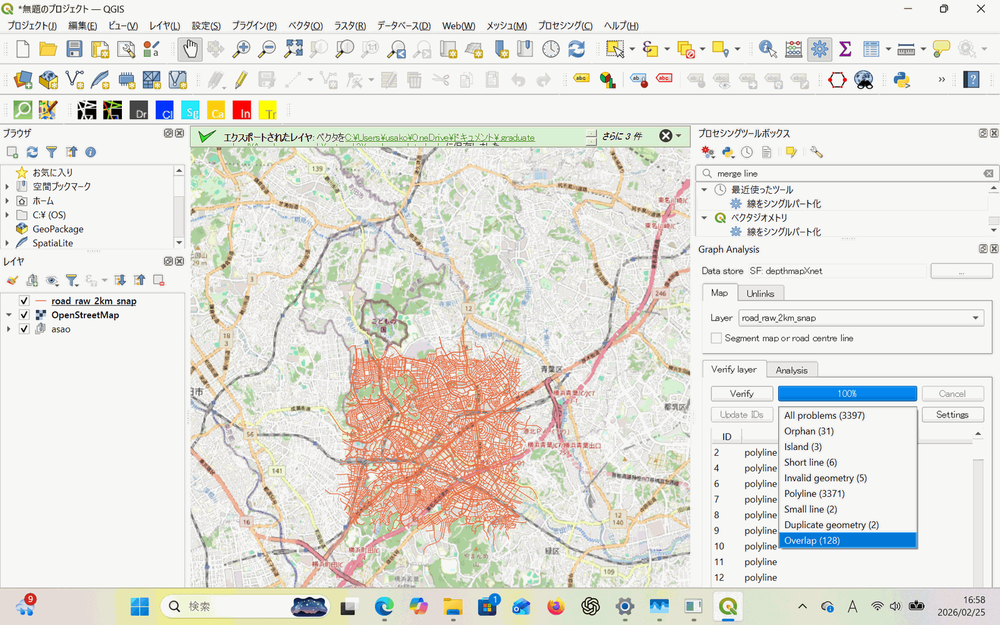
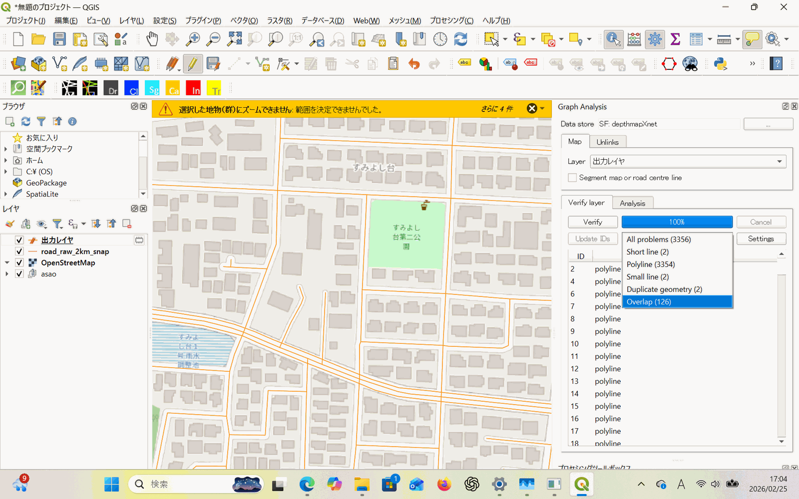
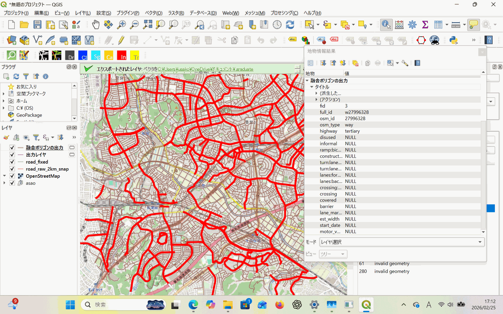

# 2026-02-25 道路整備手順

> **Summary (EN):** Documented the first road-cleaning pipeline for the OSM network before running Angular Segment Analysis in depthmapX: snapping (0.5–1.0 m), Fix Geometries, and orphan/island removal, followed by a Space Syntax Toolkit "Verify layer" check. Invalid geometries were reduced to 0, while polylines, overlaps and short lines remained; Merge Lines / Dissolve / short-line deletion were tried but dropped because they risked breaking results, and this version was used for the FOSS4G submission. The network was judged acceptable for ASA centred on R900.
>
> **Phase:** 2. Network & slope data preparation (道路・勾配データ整備) · **Tools/Data:** QGIS, Space Syntax Toolkit (Verify layer), depthmapX, OSM roads

[← 作業ログ一覧 / Work log index](README.md)

---

# ✅ 道路データ整備の手順まとめ

---

## 🟦 ① 初期データ取得（OSM）

**内容**

OpenStreetMap から道路データを抽出

（highway タグを対象）

**目的**

- 歩行者を含む街路ネットワークを得る
- depthmapX で ASA を回す元データにする

---

## 🟩 ② Snapping の実行

**内容**

- ジオメトリの Snap（0.5–1.0 m）

**目的**

- 交差点や端点が微妙にズレているのを修正
- トポロジー（接続）を安定させる

---

## 🟨 ③ Fix Geometries（無効ジオメトリの修復）

**内容**

- QGIS の Fix geometries で geometry を修正

**目的**

無効ジオメトリ（自己交差・不整合線）を修復し、

解析エンジンが読み込めるようにする

⇒orphan/islandも削除

**効果**

---

> [!NOTE]
> 以下やらない。結果が壊れる可能性あり。FOSS4Gはこれで行く

## 🟪 ④ Merge Lines

**内容**

- Merge Lines で接続された線を 1 本化

**目的**

Polyline（分割されて細かくなった線）を

できるだけ 1本にまとめる

**効果**

部分的に改善したが

PolyLine の問題はまだ残った

---

## 🟧 ⑤ Dissolve（属性ベースの統合）

**内容**

- highway 属性などをキーに Dissolve

**目的**

同じタイプの道路を属性ベースでまとめる

**効果**

Merge Lines では結合できない

同種道路の分割を統合

---

## 🟥 ⑥ Remove duplicate geometries

**内容**

- 完全に同一 geometry の線を削除

**目的**

重複線（overlap）の一部を排除

**効果**

一部 overlap の解消

⇒両街、０

---

## 🟫 ⑦ length 属性を追加して短線を判定

**内容**

- length($geometry) で短い線を選択

**目的**

short line / small line の判定と削除

**効果**

ノイズ的短線を削除したが

まだ若干残存

⇒スキップ

---

## 🟨 ⑧ Graph Analysis: Verify layer の実行

**内容**

- SST / Graph Analysis でデータ検査

**目的**

DepthmapX に適したネットワーク構造になっているか

検証するため

**結果（状況）**

以下の問題がまだ残る

| 問題 | 残存状況 |
| --- | --- |
| polyline | 多数 |
| overlap（重複） | あり |
| short/small line | 残存 |
| orphan/island | 少数 |
| invalid geometry | 0 |

※ orphan/island は消したが、geometry が問題で再発する箇所もある

---

## 🟦 ⑨ ASA 解析への準備判断

**目的**

R900 を中心に ASA（Angular Segment Analysis）を回す準備

**判断基準**

| 項目 | 許容？ | 備考 |
| --- | --- | --- |
| invalid geometry | ❌ | 修正済み |
| orphan / island | ❌ | 修正済み/残少 |
| polyline | ⚠ | 許容しつつ解析に進む |
| overlap | ⚠ | 一部許容 |
| short line | ⚠ | 許容 |

→ 解析に進んでも良い状態だが

polyline/overlap を完璧に消すには

さらに属性整理 or データ選別が必要
