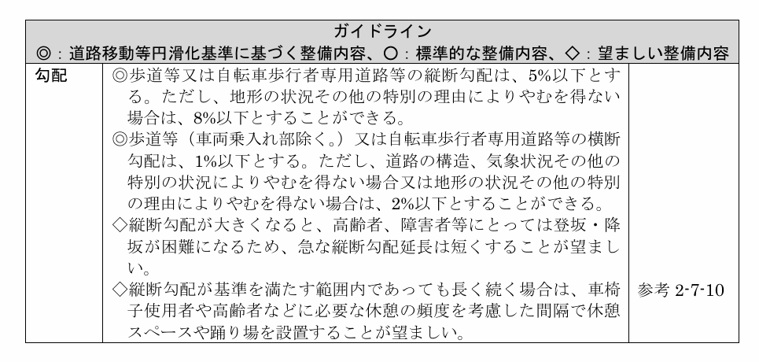
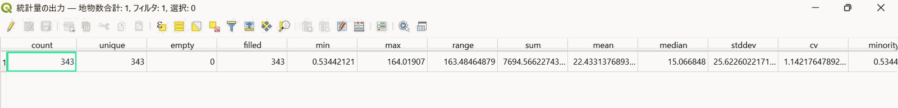
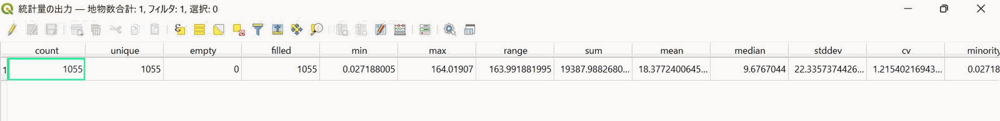
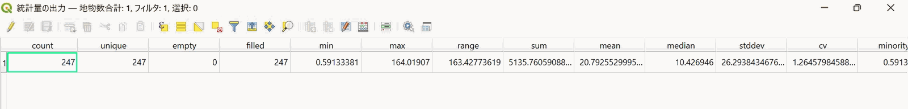
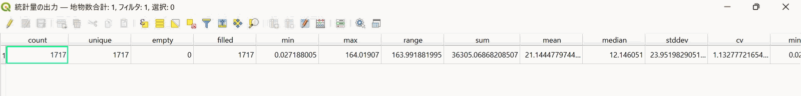

# 2026-04-03 slope付与、延長調査、Result、学会に向けて

> **Summary (EN):** Re-ran the analysis on the cleaned network with the new assumptions (ages 65–74, 47 m/min ≈ 2.8 km/h, R705) and a stricter 5% slope threshold first (possibly relaxing to 8% depending on results); "high centrality" was operationally defined as the top 20% at each radius so that cases can be compared at equal proportions. Result: high-integration 21.2%, low-gradient 53.4%, both 14.1% of 36.305 km; only 66.7% of central roads were low-gradient and 26.5% of low-gradient roads were central. The conference strategy was split: FOSS4G (R705, FOSS tools, Mapillary gap check) vs. the City Planning Institute of Japan (R705 vs R627, 65–74 vs 75+).
>
> **Phase:** 4. Method revision & conference prep (手法見直し・学会準備) · **Tools/Data:** QGIS, Space Syntax Toolkit, OSM, DEM, Mapillary

[← 作業ログ一覧 / Work log index](README.md)

---

参照：「3/5 道路データにslopeを付与」「3/7 道路の延長調査」（作業ログ内の該当ページ）

上記参照

## 勾配に関して

- 5%を最初採用
- 結果次第で、8%にする可能性あり。

*出典：国土交通省「道路の移動等円滑化に関するガイドライン」より抜粋*

## Integration値上位20％

本研究では、高中心道路を操作的に抽出するため、各半径における中心性指標の上位20％を「高中心」と定義した。これは、各ケースで同数割合の道路を抽出し、勾配条件との重ね合わせ比較を可能にするためである。

## 前提条件

対象年齢：65~74歳の高齢者

歩行速度：47m/min

## Result　（2.8km/h+5.0%以下）

以後は “ss_segments_with_grade” を母集団にして作ります。

- **p1 高統合**：`Integration >= ____(20%以上)`（上位20%の閾値 or ランク）

  
- **p2 低勾配**：` grade_pct_final_mean <= 5.1`

- **p3 両方**：`Integration >= ____(20%以上) AND grade_pct_final_mean <= 5.1`

  
- All

| length_m | Sum (m) | Sum (km) | all比（%） |
| --- | --- | --- | --- |
| p1 | 7,694.566 | 7.695 | 21.2 |
| p2 | 19,387.988 | 19.387 | 53.4 |
| p3 | 5,135.761 | 5.135 | 14.1 |
| all | 36,305.069 | 36.305 | 100.0 |

| 区分 | 意味 | 延長 (km) | 割合 |
| --- | --- | --- | --- |
| p1 | 高統合（Integration 上位20%） | 7.695 | 21.2% |
| p2 | 低勾配（grade_pct_final_mean <= 5.1） | 19.387 | 53.4% |
| p3 | 高統合 ∩ 低勾配 | 5.135 | 14.1% |
| all | 全道路 | 36.305 | 100.0% |

| 指標 | 意味 | 値 |
| --- | --- | --- |
| p3 / p1 | 高統合道路のうち低勾配な割合 | 66.7% |
| p3 / p2 | 低勾配道路のうち高統合な割合 | 26.5% |

高統合道路延長のうち約66.7%が低勾配条件を満たした。一方で、低勾配道路延長のうち高統合道路が占める割合は約26.5%であり、歩きやすい道路がそのまま構造的中心道路であるとは限らないことが示唆される。

# 学会に向けた内容確認

### FOSS4G

**主役**

- R705（65–74歳）
- QGIS / OSM / Space Syntax Toolkit / Mapillary
- 「分析結果と実空間のギャップ」

**強み**

- FOSS4Gツール活用が前面に出る
- 方法論とワークフローを見せやすい
- Mapillary 検証が効く

### 都市計画学会

**主役**

- R705 と R627 の比較
- 65–74歳と75歳以上で、中心道路の可歩行性がどう変わるか
- 高統合道路のうち低勾配な割合（p3/p1）がどう変わるか
- 駅前中心性と高齢者歩行条件の関係

**強み**

- 都市計画側の関心である、高齢者移動、駅周辺構造、歩行環境改善に寄せやすい
- 「年齢が上がると駅周辺の有効な中心軸がどう縮むか」という話ができる
