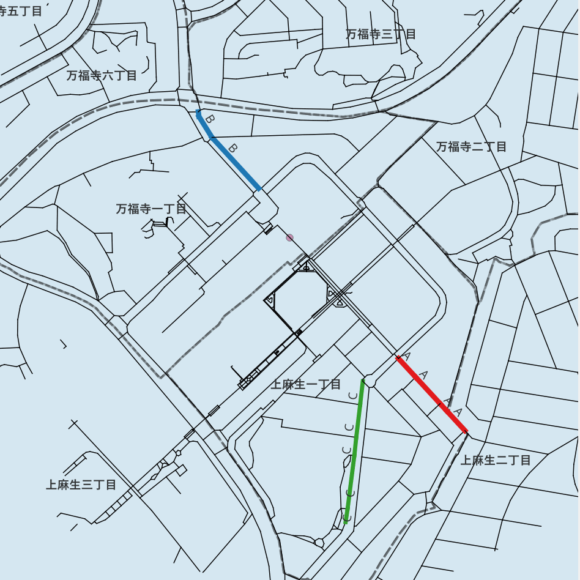

# 2026-05-10 調査準備

> **Summary (EN):** Prepared the Shin-Yurigaoka field survey. The route table was finalised: Route A, the pedestrian-space route, is updated to 152.0 m, Route B, the practical access route, is 137.8 m, and Route C is put on hold. The day's schedule was narrowed to simultaneous counts of A and B (15 min) followed by 40 min of interviews, with two surveyors. Survey sheets were created for surveyors and for respondents (five-point rating sheet).
>
> **Phase:** 5. Second site & field survey (流山・現地調査) · **Tools/Data:** QGIS route selection, survey sheets (count / environment checklist / interview)

[← 作業ログ一覧 / Work log index](README.md)

---

## RouteA/B/C

| Route | 距離 | 特徴 | 研究上の役割 |
| --- | --- | --- | --- |
| A | 152.0m | ペデストリアンデッキの延長、歩行空間が広い、商業施設近い、住宅地側(上麻生)へ続く、休憩場所あり | 駅前歩行者空間型ルート |
| B | 137.8m | 万福寺方面からの主要道路、やや勾配、車道沿い、駅アクセス必須感がある | 実用的駅アクセス型ルート |
| C | 198.6m | 緑が多い、歩車分離、歩道広い、休憩場所あり、なだらかな坂が長く続く、上麻生方面と駅をつなぐ道 | 快適・緑あり・長めの歩行環境型ルート |
| ~~第二候補 B~~ | 247.0m | 歩道狭め、歩車分離あり、なだらかな坂、消防署・市役所にアクセス可 | 行政施設方面アクセス型ルート |

### RouteA

→ [A候補：NAIN_top20 AND NACH_top20 AND slope_5（2026-05-08 研究詰め 付録）](2026-05-08_research-refinement.md#付録-a候補nain_top20-and-nach_top20-and-slope_5)

### RouteB

→ [B候補：NAIN_top30 AND NACH_top20 AND slope_5（2026-05-08 研究詰め 付録）](2026-05-08_research-refinement.md#付録-b候補nain_top30-and-nach_top20-and-slope_5)

### RouteC(保留)

## 流れ

| 時間 | 調査員1 | 調査員2 | 目的 |
| --- | --- | --- | --- |
| 10:00–10:15 | Aカウント | Bカウント | A×Cの主比較 |
| 10:15–10:55 | Aヒアリング | Bヒアリング | 経路選択理由の把握 |
| 10:55–11:00 | A現地メモ・写真 | B現地メモ・写真 | 環境記録 |

## 調査内容

→ [質問内容（2026-05-08 研究詰め 付録）](2026-05-08_research-refinement.md#付録-質問内容)

### 調査シート類

（添付: 調査員用メモシート_RouteAB.docx, 元ファイルは非公開）

（添付: 回答者用_五段階評価シート_A4_v3.docx, 元ファイルは非公開）
