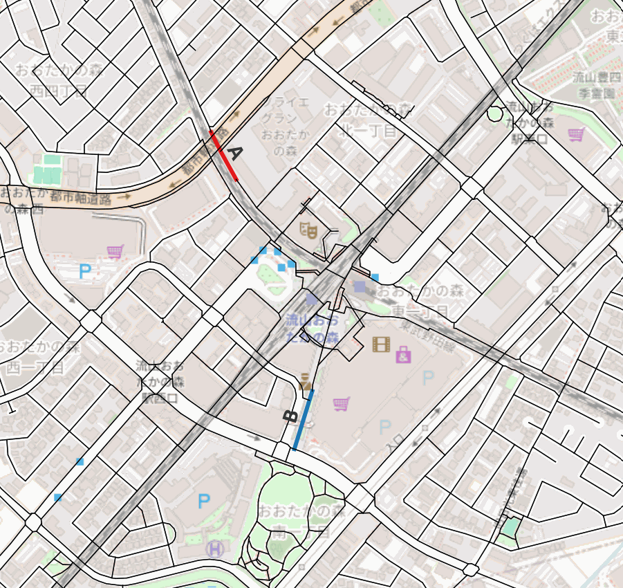
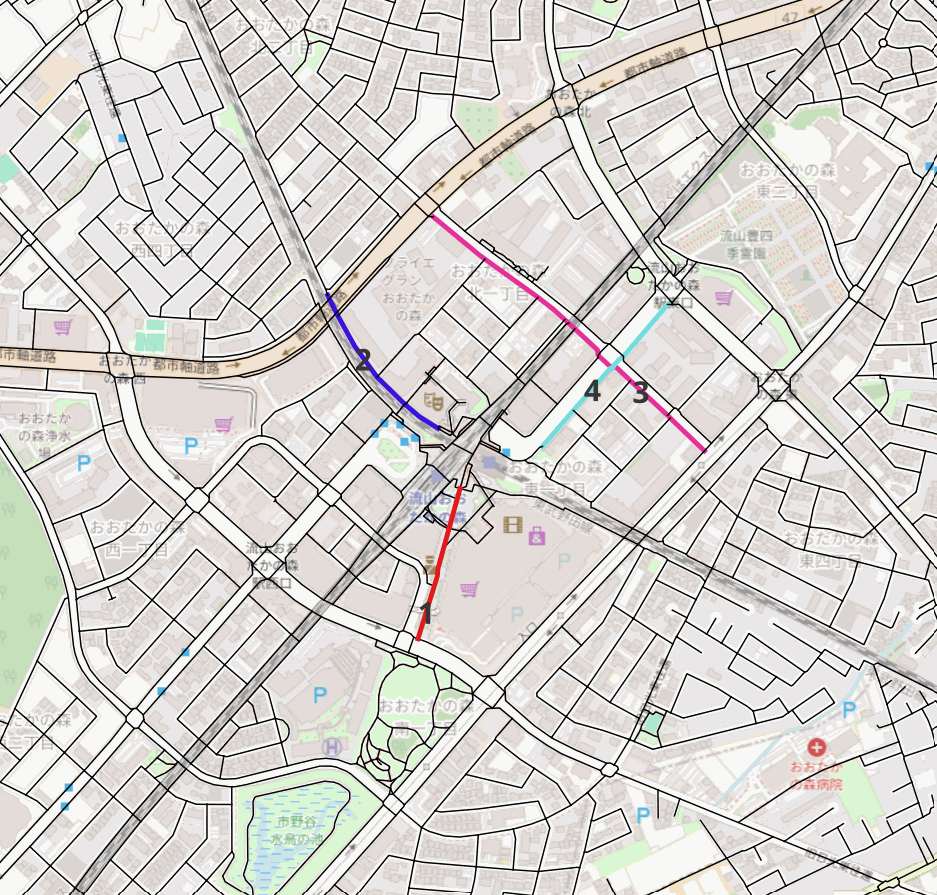
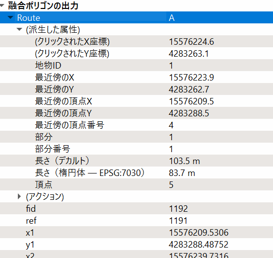
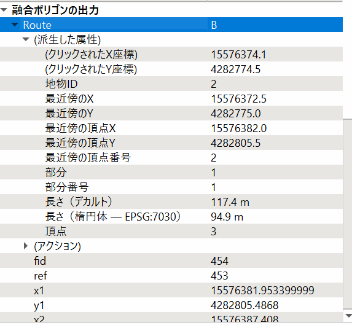

# 2026-05-12 流山おおたかの森駅

> **Summary (EN):** Set the Nagareyama-Otakanomori survey routes and compared their character with the Shin-Yurigaoka routes. The two sites have their route types swapped: at Nagareyama, A is the practical access route along the railway and B is the plaza-side pedestrian space. Mapillary capture routes were also chosen. Candidates were limited to the NAIN/NACH top-30% streets and checked against gaps in existing Mapillary coverage; four segments were selected because they had no data, only night-time imagery, or no pedestrian-eye-level imagery.
>
> **Phase:** 5. Second site & field survey (流山・現地調査) · **Tools/Data:** QGIS, Space Syntax (NAIN / NACH), Mapillary, OpenStreetMap

[← 作業ログ一覧 / Work log index](README.md)

---

- RouteA → [付録: RouteA](#付録-routea)
- RouteB → [付録: RouteB](#付録-routeb)

| 地区 | Route A | Route B |
| --- | --- | --- |
| 新百合ヶ丘 | 駅前歩行者空間型。快適、整備、商業施設・飲食店沿い、車道との分離、緑も比較的ある | 実用型アクセス路。万福寺方面から駅へ向かう。車道沿い、勾配あり、歩道幅狭め |
| 流山おおたかの森 | 実用型アクセス路。住宅街・マンション群から駅へ向かう線路沿い。商業・飲食機能は少ない | 駅前歩行者空間型。広場・公園と接続し、広く整備された歩行空間 |

## Mapillary Route

### 選定条件

- NAIN30%、NACH30%の範囲で絞り込む
- OSMのMapillaryアップロード状況から、足りない/未整備と思われる箇所と上記の範囲を照合
- 1は2025年に撮影済みだが、RouteAの場所であると共に、夜の撮影のみだったため行うべきだと判断した
- 2は電車の中から見えるが、歩行者目線のデータはなかったため実施する
- 3,4はそもそもデータがなかった

---

## 付録: RouteA

> *（画像: Google ストリートビューの画面のため非掲載）*

- 長さ楕円体の方をみる

> *（画像: Google Earth の画面のため非掲載（ルート長・標高の計測に使用））*

## 付録: RouteB

> *（画像: Google ストリートビューの画面のため非掲載）*

